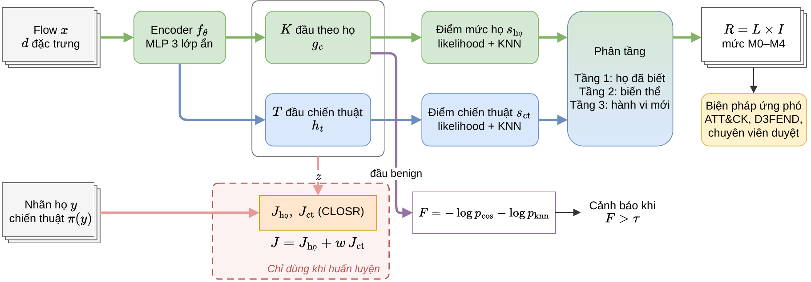

# HC-CLOSR

Phát hiện tấn công mạng Out-of-Domain (OOD) và đề xuất biện pháp ứng phó bằng học tương phản ở hai mức: họ tấn công và chiến thuật ATT&CK. Project 3, HUST, kỳ 20261.

**Vì sao làm.** Mô hình phân loại đạt gần 100% với tấn công đã biết, nhưng có thể coi một họ tấn công mới là lưu lượng bình thường. Ngay cả khi phát hiện được, cảnh báo "chưa biết" không cho người vận hành căn cứ để hành động. Biện pháp phòng thủ của D3FEND gắn với kỹ thuật tấn công, không gắn với tên họ, nên nếu đoán được chiến thuật thì vẫn đề xuất được biện pháp cho một tấn công chưa có tên.

## Đầu vào và đầu ra

**Đầu vào:** một flow mạng, biểu diễn bằng vector đặc trưng số đã chuẩn hoá z-score theo tập huấn luyện: 66 đặc trưng với LYCOS, 40 hoặc 41 đặc trưng với NetFlow v3. Mô hình không dùng IP, cổng, mốc thời gian và các trường phụ thuộc ngăn xếp TCP. Khi huấn luyện, mỗi flow có thêm nhãn họ tấn công và chiến thuật tương ứng. Dữ liệu cụ thể xem [datasets/README.md](datasets/README.md).

**Đầu ra** của mỗi flow:

| Đầu ra | Ý nghĩa |
|---|---|
| Điểm tấn công `F` | Càng cao càng lạ so với lưu lượng bình thường. Cảnh báo khi `F` vượt phân vị 95 của flow bình thường ở tập kiểm định |
| Tầng | 1: họ đã biết. 2: biến thể của chiến thuật đã biết. 3: hành vi mới |
| Họ gần nhất, chiến thuật | Lớp đã biết gần nhất và chiến thuật ATT&CK dự đoán |
| Rủi ro `R = L × I` và mức M0–M4 | `L` từ điểm OOD, `I` theo chiến thuật |
| Biện pháp ứng phó | Tra theo chiến thuật trong D3FEND. Tầng 3 dùng biện pháp chung có thời hạn. Hành động mạnh phải có chuyên viên duyệt |

Ví dụ thật: một flow Slowloris đưa vào mô hình chưa từng học họ này (`HCDetector.analyze`). Mô hình không biết tên họ, nhưng xếp vào tầng 2, nhận ra chiến thuật Impact và đề xuất biện pháp của chiến thuật đó:

```json
{"tier": 2, "family": "dos_slowhttptest", "score": 2.328, "status": "alert", "tactic": "impact",
 "L": 2, "I": 4, "R": 8, "level": "M2", "action": "hạn chế mềm: giới hạn kết nối mới theo nguồn, thu thập bằng chứng",
 "mode": "tự động, báo chuyên viên", "d3fend_now": ["Inbound Traffic Filtering", "Network Traffic Filtering"]}
```

## Kiến trúc



Encoder MLP sinh một embedding 64 chiều cho mỗi họ và mỗi chiến thuật. Hàm mất mát CLOSR (Wilkie 2026) được áp dụng ở cả hai mức. Điểm OOD gồm likelihood và khoảng cách KNN. Điểm tấn công `F` kết hợp khoảng cách tới tâm benign và khoảng cách KNN tới flow benign theo phương pháp Fisher. Hình gốc ở [docs/architecture.drawio](docs/architecture.drawio).

## Nhóm chiến thuật

Mỗi họ tấn công được gán một chiến thuật ATT&CK theo mục tiêu của kẻ tấn công. Bảng này do đề tài tự lập theo ý nghĩa của họ, không học từ dữ liệu, và chưa được chuyên gia thẩm định. Cấu hình ở mục `tactics` của `conf/dataset/*.yaml`, biện pháp ở `src/response.py`.

| Chiến thuật | Mục tiêu | LYCOS-IDS2017 | NF-ToN-IoT-v3 | NF-CICIDS2018-v3 | Biện pháp ngay |
|---|---|---|---|---|---|
| Impact | Làm gián đoạn dịch vụ | DoS, DDoS | DDoS, DoS, Ransomware | DDoS, DoS | Lọc lưu lượng vào |
| Credential Access | Lấy thông tin đăng nhập | SSH, FTP-Patator, Web Brute Force | Password, MITM | SSH, FTP Brute Force, Web Brute Force | Lọc lưu lượng, thu hồi thông tin xác thực |
| Initial Access | Khai thác dịch vụ công khai | XSS, SQL Injection, Heartbleed | XSS, Injection | XSS, SQL Injection | Lọc lưu lượng vào |
| Command and Control | Điều khiển máy đã chiếm | Bot | Backdoor | Bot | Lọc lưu lượng ra, chặn DNS |
| Discovery | Dò tìm máy và dịch vụ | PortScan | Scanning | | Giới hạn kết nối mới (tự đề xuất) |
| Lateral Movement | Di chuyển trong mạng | | | Infiltration | Biện pháp chung |

## Kết quả

Phát hiện họ tấn công OOD, trung bình trên 23 họ thuộc ba tập dữ liệu, dạng AUROC / TPR tại FPR 5%:

| Tập dữ liệu | XGBoost | IForest | KNN | CLOSR | HC-CLOSR |
|---|---|---|---|---|---|
| NF-ToN-IoT-v3 (9 họ) | 0,892 / 0,385 | 0,884 / 0,258 | 0,910 / 0,466 | 0,931 / 0,460 | **0,945 / 0,633** |
| LYCOS-IDS2017 (4 họ) | **0,952 / 0,743** | 0,765 / 0,146 | 0,880 / 0,136 | 0,932 / 0,435 | 0,951 / 0,663 |
| NF-CICIDS2018-v3 (10 họ) | 0,791 / 0,576 | 0,812 / 0,270 | 0,920 / 0,717 | 0,910 / 0,766 | **0,939 / 0,814** |
| Trung bình 23 họ | 0,859 / 0,531 | 0,832 / 0,244 | 0,909 / 0,518 | 0,922 / 0,589 | **0,943 / 0,717** |

HC-CLOSR đứng đầu về trung bình, nhưng thua XGBoost ở PortScan, Slowloris của LYCOS, và không vượt XGBoost khi huấn luyện, kiểm thử trên hai mạng khác nhau. Đầu chiến thuật chưa cải thiện phát hiện lẫn suy luận chiến thuật so với CLOSR.

## Chạy lại

Cần GPU. Toàn bộ thực nghiệm chạy trên một A100 mất vài giờ.

```bash
pip install -r requirements.txt
git clone https://github.com/jackwilkie/CLOSR third_party/CLOSR   # mã gốc của CLOSR
bash scripts/prepare_data.sh
export OUT_ROOT=outputs CACHE_DIR=cache

# Một lần chạy: giấu họ DDoS của NF-ToN-IoT-v3
python -m src.run dataset=nf_ton protocol.heldout=ddos model=hc_closr
# Chéo tập dữ liệu
python -m src.run dataset=nf_ton protocol=cross protocol.target=nf_cic model=hc_closr
# Toàn bộ bài báo
python scripts/grid.py > runs.txt
python scripts/run_queue.py runs.txt 12 outputs
python scripts/summarize.py outputs/jobs summary.csv
```

Mô hình có sẵn: `hc_closr`, `closr_knn` (bỏ đầu chiến thuật), `closr`, `xgboost`, `iforest`, `raw_knn`, `stump`, `tabpfn`. Thêm `clean=false` để giữ các đặc trưng phụ thuộc ngăn xếp TCP. Lý do loại các đặc trưng này xem [datasets/README.md](datasets/README.md).

## Cấu trúc

| Thư mục | Nội dung |
|---|---|
| `conf/` | Cấu hình Hydra: `dataset/`, `protocol/`, `model/` |
| `src/` | `data.py` nạp và tách dữ liệu, `netflow.py` chuyển đổi NetFlow v3, `models.py` các mô hình, `hc_detector.py` suy luận HC-CLOSR, `response.py` đề xuất biện pháp ứng phó, `metrics.py` độ đo, `run.py` một lần chạy |
| `src/` (web) | `closr_detector.py` CLOSR với trọng số gốc, `export.py` xuất mô hình, `simulator.py`, `stream.py` luồng giả lập |
| `scripts/` | `prepare_data.sh`, `grid.py` danh sách lần chạy, `run_queue.py` chạy song song, `summarize.py` tổng hợp, `kaggle/` huấn luyện mô hình cho web, `colab_ssh.sh` |
| `datasets/` | Mô tả dữ liệu, không chứa dữ liệu |
| `deploy/`, `web/` | API trên Modal và giao diện Next.js |
| `demo/` | Demo khép kín trên máy: cổng web, phát hiện, Telegram, quyết định và chặn |
| `notebooks/` | `colab.ipynb` mở SSH vào phiên Colab |
| `docs/` | Hình kiến trúc |
| `agents/` | Ghi chép cho agent, xem `CLAUDE.md` |

## Web demo

https://project3-ids.vercel.app gồm hai tab. Giám sát trực tiếp phát lại flow của LYCOS-IDS2017 theo kịch bản tấn công giả lập, gom cảnh báo thành sự cố và đề xuất biện pháp ứng phó. Phân tích file nhận CSV và trả về kết quả từng flow. Hành động chỉ là mô phỏng, chưa nối với tường lửa thật.

Triển khai:

```bash
pip install modal pyyaml
python deploy/setup_modal.py                          # tạo secret từ .env
PYTHONPATH=. modal run deploy/modal_app.py::main      # dựng CLOSR từ trọng số gốc
PYTHONPATH=. modal run deploy/modal_app.py::stream    # dựng kho flow và nạp kịch bản
modal volume put project3-model <thư mục> /hc_closr   # nạp HC-CLOSR, thư mục do scripts/kaggle xuất ra
PYTHONPATH=. modal deploy deploy/modal_app.py
```

Web cần ba biến môi trường trên Vercel: `MODAL_API_URL`, `MODAL_LIVE_URL`, `MODAL_API_KEY`. Sự cố từ mức M3 được báo qua Telegram nếu có `TELEGRAM_BOT_TOKEN` và `TELEGRAM_CHAT_ID` trong `.env`.

Mô hình trên web được huấn luyện khi giấu Slowloris và chưa loại đặc trưng phụ thuộc ngăn xếp TCP (`clean=false`).
